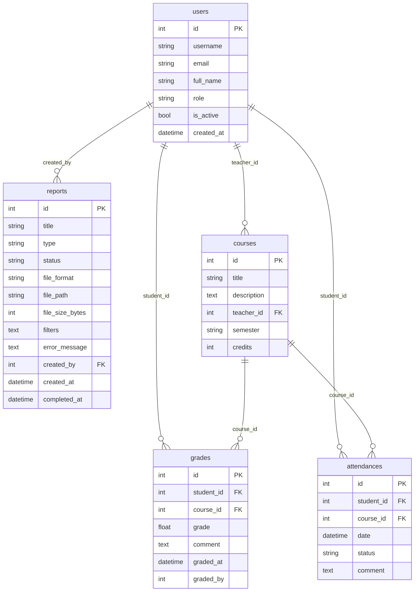

# Техническое задание: Backend модуля «Отчёты» (Reports)

## 1. Назначение модуля

Модуль «Отчёты» (Reports) предназначен для формирования сводной аналитики, ведомостей успеваемости и табелей посещаемости в College Management System. Модуль агрегирует данные об оценках, посещаемости занятий, преподавателях и курсах, формирует сводные показатели для дашбордов, а также генерирует готовые документы в форматах PDF и Excel для печати и архивации.

Backend модуля предоставляет REST API для постановки задач на генерацию, проверки их статуса, управления готовыми отчётами и скачивания файлов.

**Разграничение доступа по ролям:**
- `admin` — полный доступ: генерация любых отчётов, сводная аналитика по всему колледжу, удаление и просмотр всех отчётов.
- `teacher` — генерация ведомостей успеваемости и посещаемости по назначенным ему курсам (`courses.teacher_id == current_user.id`), скачивание своих отчётов.
- `student` — просмотр личной аналитики и скачивание персональных табелей оценок и посещаемости.

---

## 2. Функциональные требования

### 2.1. Основные функции

- **Генерация отчёта по успеваемости (`performance`):** формирование сводной ведомости оценок по курсу за выбранный период или семестр; расчёт среднего балла (GPA), распределения оценок и рейтинга студентов.
- **Генерация отчёта по посещаемости (`attendance`):** расчёт процентов посещаемости занятий, количества пропусков по уважительной и неуважительной причинам в разрезе курсов и студентов.
- **Сводная статистика колледжа (`summary`):** агрегированные показатели для административной панели (общее число студентов, преподавателей, активных курсов, средний балл по колледжу, процент посещаемости).
- **Экспорт в популярные форматы:** генерация отчётов в виде документов PDF (с использованием библиотеки `reportlab`) и таблиц Excel (формат `.xlsx` с использованием `openpyxl`).
- **Асинхронная/фоновая обработка:** поддержка статусной модели генерации (`pending` → `generating` → `ready` / `failed`) для длительных отчётов с проверкой прогресса.
- **Управление отчётами:** просмотр реестра созданных отчётов с пагинацией и фильтрами по статусу и типу, получение метаданных отчёта, скачивание и удаление файлов.

### 2.2. Пользовательские сценарии

**Сценарий 1: Преподаватель формирует ведомость успеваемости по курсу в PDF**
1. Преподаватель в интерфейсе выбирает курс (например, «Разработка программных модулей»), указывает семестр, формат `pdf` и нажимает «Сформировать отчёт».
2. Frontend отправляет `POST /api/v1/reports/generate`.
3. Backend проверяет права (пользователь является преподавателем данного курса либо администратором), валидирует фильтры, создаёт запись в БД со статусом `generating`.
4. Модуль агрегирует оценки из таблицы `grades`, вычисляет средний балл каждого студента, формирует PDF-файл в `storage/reports/` и переводит статус в `ready`.
5. Преподаватель видит отчёт в списке и скачивает файл через `GET /api/v1/reports/{report_id}/download`.

**Сценарий 2: Выгрузка табеля посещаемости в Excel**
1. Куратор или преподаватель запрашивает отчёт по посещаемости за период с указанием формата `excel`.
2. Backend производит выборку из таблицы `attendances`, группирует статусы посещений по датам и студентам, рассчитывает процент присутствия.
3. Формируется файл `.xlsx` со стилизованными заголовками и цветовой разметкой пропусков. Пользователь скачивает сформированную таблицу.

**Сценарий 3: Администратор запрашивает сводную статистику для дашборда**
1. Администратор открывает главную страницу аналитики колледжа.
2. Frontend выполняет запрос `GET /api/v1/reports/statistics/summary`.
3. Backend агрегирует актуальные данные из таблиц ядра системы (`users`, `courses`, `grades`, `attendances`) и мгновенно возвращает JSON с ключевыми метриками.

**Сценарий 4: Студент просматривает личный табель**
1. Студент запрашивает генерацию отчёта по своим оценкам.
2. Backend автоматически подставляет `student_id = current_user.id`, исключая доступ к оценкам других студентов.
3. Студент скачивает персональную выписку успеваемости.

**Сценарий 5: Удаление старого отчёта**
1. Пользователь нажимает «Удалить» напротив устаревшего отчёта в своём списке.
2. Backend удаляет физический файл с диска и запись из таблицы `reports`.

---

## 3. Нефункциональные требования

- **Производительность:**
  - Время ответа для метаданных, списков и сводной статистики — не более 1 секунды.
  - Синхронная генерация отчёта небольшого объёма (< 100 записей) — не более 2 секунд.
  - Постановка в очередь генерации — не более 0.3 секунды.
  - Скачивание готового файла — ограничено только скоростью сети клиента.
- **Безопасность:**
  - Все эндпоинты защищены JWT-авторизацией через заголовок `Authorization: Bearer <token>`.
  - Ролевая модель доступа (RBAC) на основе `UserRole` из `core.models`.
  - Запрет несанкционированного доступа к чужим файлам: доступ к скачиванию отчёта имеет только его автор либо пользователь с ролью `admin`.
- **Совместимость и архитектура:**
  - Модуль располагается в `modules/reports/` и следует единому паттерну системы (`router.py`, `models.py`, `schemas.py`, `services/`, `tests/`).
  - Подключение к БД и базовые классы ORM импортируются из `core.database` (`Base`, `get_db`).
  - Данные пользователей, курсов, оценок и посещаемости берутся напрямую из моделей `core.models` (`User`, `Course`, `Grade`, `Attendance`).
  - Роутер подключается в `core/api.py` через `app.include_router(reports_router)`.
  - Соответствие стандарту PEP 8, проверки `flake8` без предупреждений, тесты запускаются через `pytest`.
- **Форматы данных:**
  - API: JSON (UTF-8), даты в стандарте ISO 8601 (`YYYY-MM-DD` или `YYYY-MM-DDTHH:MM:SS`).
  - Документы: PDF (`application/pdf`), Excel OpenXML (`application/vnd.openxmlformats-officedocument.spreadsheetml.sheet`).
- **Файловое хранилище:**
  - Локальная папка `storage/reports/` с автосозданием при инициализации приложения. Имена файлов формируются по шаблону: `report_{id}_{uuid}.{ext}` во избежание коллизий.

---

## 4. Интерфейсы

### 4.1. API Endpoints

Раздел согласован в рамках API-контракта с frontend-командой модуля (issue #22).

#### Общие правила контракта
- Базовый префикс всех маршрутов: `/api/v1/reports`.
- Авторизация: заголовок `Authorization: Bearer <token>`.
- Формат ошибок: `{"detail": "Описание ошибки"}` (HTTP-статусы `401`, `403`, `404`, `409`).
- Ошибка валидации: статус `422 Unprocessable Entity` (стандартный формат FastAPI/Pydantic).
- Списки объектов возвращаются в структуре пагинации:
  ```json
  {
    "items": [...],
    "total": 42,
    "page": 1,
    "page_size": 20
  }
  ```
  Параметры пагинации: `page` (по умолчанию 1, `ge=1`), `page_size` (по умолчанию 20, `ge=1`, `le=100`).

#### Сводная таблица эндпоинтов

| Метод  | Endpoint                              | Описание                                  | Успешный ответ | Коды ошибок         |
| :----- | :------------------------------------ | :---------------------------------------- | :------------- | :------------------ |
| GET    | `/api/v1/reports`                     | Реестр отчётов текущего пользователя     | 200 OK         | 401, 422            |
| GET    | `/api/v1/reports/{report_id}`         | Получить детальную информацию об отчёте   | 200 OK         | 401, 403, 404       |
| POST   | `/api/v1/reports/generate`            | Запустить формирование нового отчёта      | 202 Accepted   | 401, 403, 422       |
| GET    | `/api/v1/reports/{report_id}/status`  | Проверить статус выполнения генерации     | 200 OK         | 401, 403, 404       |
| GET    | `/api/v1/reports/{report_id}/download`| Скачать сгенерированный файл (PDF/Excel)  | 200 OK         | 401, 403, 404, 409  |
| DELETE | `/api/v1/reports/{report_id}`         | Удалить отчёт и связанный файл            | 204 No Content | 401, 403, 404       |
| GET    | `/api/v1/reports/statistics/summary`  | Сводная аналитика по колледжу (для админа)| 200 OK         | 401, 403            |

---

#### Детальное описание эндпоинтов

##### 1. Объект отчёта (`ReportResponse`)

Во всех ответах метаданных возвращается JSON-объект отчёта:

```json
{
  "id": 15,
  "title": "Ведомость успеваемости по курсу: Информатика",
  "type": "performance",
  "status": "ready",
  "file_format": "pdf",
  "filters": {
    "course_id": 3,
    "semester": "1",
    "date_from": "2026-09-01",
    "date_to": "2026-10-01"
  },
  "file_size_bytes": 145820,
  "created_by": 5,
  "created_at": "2026-10-03T12:00:00",
  "completed_at": "2026-10-03T12:00:03",
  "error_message": null
}
```

*Допустимые значения `type`:* `performance` (успеваемость), `attendance` (посещаемость), `summary` (общая статистика).  
*Допустимые значения `status`:* `pending` (в очереди), `generating` (формируется), `ready` (готов к скачиванию), `failed` (ошибка при формировании).  
*Допустимые значения `file_format`:* `pdf`, `excel`.

---

##### 2. `GET /api/v1/reports`
**Назначение:** Получение списка отчётов, сформированных текущим пользователем (администратор видит отчёты всех пользователей).

**Query-параметры (все необязательные):**
- `type` (string): фильтр по типу (`performance`, `attendance`, `summary`).
- `status` (string): фильтр по статусу (`pending`, `generating`, `ready`, `failed`).
- `page` (integer, default: 1): номер страницы.
- `page_size` (integer, default: 20, max: 100): размер страницы.

**Успешный ответ (`200 OK`):**
```json
{
  "items": [
    {
      "id": 15,
      "title": "Ведомость успеваемости по курсу: Информатика",
      "type": "performance",
      "status": "ready",
      "file_format": "pdf",
      "filters": {
        "course_id": 3,
        "semester": "1"
      },
      "file_size_bytes": 145820,
      "created_by": 5,
      "created_at": "2026-10-03T12:00:00",
      "completed_at": "2026-10-03T12:00:03",
      "error_message": null
    }
  ],
  "total": 1,
  "page": 1,
  "page_size": 20
}
```

---

##### 3. `GET /api/v1/reports/{report_id}`
**Назначение:** Получение карточки одного отчёта по его идентификатору.

**Параметры пути:** `report_id` (integer) — идентификатор отчёта.

**Успешный ответ (`200 OK`):** объект отчёта (`ReportResponse`).

**Ошибки:**
- `401 Unauthorized` — токен отсутствует или истёк.
- `403 Forbidden` — попытка просмотра отчёта другого пользователя.
- `404 Not Found` — `{"detail": "Отчёт с указанным ID не найден"}`.

---

##### 4. `POST /api/v1/reports/generate`
**Назначение:** Запуск формирования нового отчёта.

**Тело запроса (`ReportCreateRequest`):**
```json
{
  "title": "Ведомость успеваемости по курсу: Информатика",
  "type": "performance",
  "file_format": "pdf",
  "filters": {
    "course_id": 3,
    "semester": "1",
    "date_from": "2026-09-01",
    "date_to": "2026-10-01"
  }
}
```

| Поле | Тип | Обязательно | Описание |
| :--- | :--- | :--- | :--- |
| `title` | string | нет | Человекочитаемое название отчёта (если не указано — генерируется автоматически) |
| `type` | string | да | Тип отчёта: `performance`, `attendance` или `summary` |
| `file_format` | string | нет | Формат файла: `pdf` или `excel` (по умолчанию `pdf`) |
| `filters` | object | да | Параметры выборки данных (зависят от типа отчёта) |

*Параметры фильтров:*
- Для `performance`: `course_id` (integer, обязателен для преподавателя), `semester` (string), `date_from` (date), `date_to` (date).
- Для `attendance`: `course_id` (integer, обязателен для преподавателя), `date_from` (date), `date_to` (date).
- Для `summary`: доступно только администраторам.

**Успешный ответ (`202 Accepted`):**
```json
{
  "report_id": 15,
  "status": "generating",
  "message": "Генерация отчёта запущена в фоновом режиме"
}
```

**Ошибки:**
- `401 Unauthorized` — не передан токен.
- `403 Forbidden` — у пользователя нет прав на выбранный курс или тип отчёта.
- `422 Unprocessable Entity` — невалидные даты (`date_from > date_to`) или отсутствуют обязательные поля.

---

##### 5. `GET /api/v1/reports/{report_id}/status`
**Назначение:** Опрос статуса генерации отчёта (поллинг для frontend).

**Успешный ответ (`200 OK`):**
```json
{
  "report_id": 15,
  "status": "generating",
  "progress_percent": 65,
  "error_message": null
}
```
*При статусе `ready`:*
```json
{
  "report_id": 15,
  "status": "ready",
  "progress_percent": 100,
  "error_message": null
}
```

---

##### 6. `GET /api/v1/reports/{report_id}/download`
**Назначение:** Скачивание готового бинарного файла сформированного отчёта.

**Успешный ответ (`200 OK`):**
- Заголовки для PDF:
  - `Content-Type: application/pdf`
  - `Content-Disposition: attachment; filename="report_15.pdf"`
- Заголовки для Excel:
  - `Content-Type: application/vnd.openxmlformats-officedocument.spreadsheetml.sheet`
  - `Content-Disposition: attachment; filename="report_15.xlsx"`

**Ошибки:**
- `403 Forbidden` — нет прав на скачивание данного файла.
- `404 Not Found` — отчёт или файл на диске не найден.
- `409 Conflict` — `{"detail": "Отчёт ещё формируется или завершился с ошибкой"}` (если `status != 'ready'`).

---

##### 7. `DELETE /api/v1/reports/{report_id}`
**Назначение:** Удаление записи отчёта и связанного файла из хранилища.

**Успешный ответ (`204 No Content`):** тело ответа пустое.

**Ошибки:**
- `403 Forbidden` — попытка удаления чужого отчёта.
- `404 Not Found` — отчёт не найден.

---

##### 8. `GET /api/v1/reports/statistics/summary`
**Назначение:** Получение сводных агрегированных показателей системы для аналитического дашборда администратора.

**Успешный ответ (`200 OK`):**
```json
{
  "total_students": 250,
  "total_teachers": 28,
  "total_courses": 42,
  "college_average_grade": 4.35,
  "college_attendance_rate": 89.4,
  "top_courses_by_performance": [
    {
      "course_id": 3,
      "course_title": "Разработка программных модулей",
      "average_grade": 4.72
    }
  ],
  "reports_generated_total": 156
}
```

**Ошибки:**
- `403 Forbidden` — эндпоинт доступен только администраторам (`UserRole.ADMIN`).

---

### 4.2. Взаимодействие с другими модулями

- **`core/` (Ядро системы):**
  - `core.database`: сессия БД (`get_db`), базовый класс декларативных моделей `Base`.
  - `core.auth`: получение текущего пользователя и ролей через `Depends(get_current_user)`.
  - `core.models.User`: проверка авторства и ролей (`UserRole.ADMIN`, `UserRole.TEACHER`, `UserRole.STUDENT`).
  - `core.models.Course`: получение названия курсов, преподавателей и привязок.
  - `core.models.Grade`: агрегация оценок для расчёта успеваемости и рейтинга.
  - `core.models.Attendance`: подсчёт посещаемости, пропусков и коэффициента присутствия.
- **`frontend/reports/` (Клиентская часть):**
  - Полное соответствие контракту эндпоинтов раздела 4.1 для таблиц, форм фильтрации и скачивания.

---

## 5. Структура базы данных

### 5.1. Таблицы модуля

**Таблица:** `reports` (создаётся модулем Reports)

| Поле | Тип | Nullable | Описание |
| :--- | :--- | :--- | :--- |
| `id` | Integer | Нет | Первичный ключ (Primary Key, autoincrement) |
| `title` | String(200) | Нет | Название отчёта для отображения в списке |
| `type` | String(50) | Нет | Тип отчёта: `performance`, `attendance`, `summary` |
| `status` | String(20) | Нет | Статус: `pending`, `generating`, `ready`, `failed` |
| `file_format` | String(10) | Нет | Формат файла: `pdf` или `excel` |
| `file_path` | String(255) | Да | Относительный путь к сохранённому файлу на диске |
| `file_size_bytes` | Integer | Да | Размер файла в байтах |
| `filters` | Text (JSON) | Да | Сериализованные параметры фильтрации в формате JSON |
| `error_message` | Text | Да | Текст ошибки в случае сбоя генерации |
| `created_by` | Integer | Нет | Внешний ключ на `users.id` (создатель отчёта) |
| `created_at` | DateTime | Нет | Дата и время создания запроса |
| `completed_at` | DateTime | Да | Дата и время завершения генерации |

---

### 5.2. Внешние таблицы, используемые модулем (только чтение)

- **`users` (`core.models.User`):** проверка ролей (`role`), отображение ФИО создателя и студентов (`full_name`).
- **`courses` (`core.models.Course`):** наименование курса (`title`), семестр (`semester`), проверка преподавателя (`teacher_id`).
- **`grades` (`core.models.Grade`):** выборка оценок (`grade`, `student_id`, `course_id`, `graded_at`).
- **`attendances` (`core.models.Attendance`):** выборка статусов посещений (`status`, `student_id`, `course_id`, `date`).

---

## 6. Критерии приёмки

- [ ] Все эндпоинты из раздела 4.1 реализованы и соответствуют API-контракту.
- [ ] Ролевое разграничение прав работает корректно (проверка токена, ролей `admin`, `teacher`, `student`).
- [ ] Генерация документов в формате PDF формирует валидный файл с таблицами и итоговыми метриками.
- [ ] Генерация таблиц Excel формирует валидный файл `.xlsx` с заголовками и форматированием.
- [ ] Файлы корректно сохраняются в `storage/reports/` и отдаются клиенту через эндпоинт скачивания.
- [ ] Удаление отчёта очищает как запись в базе данных, так и файл на диске.
- [ ] Написаны модульные и интеграционные тесты с использованием `TestClient` и `pytest`.
- [ ] Покрытие тестами включает сценарии `200`, `202`, `401`, `403`, `404`, `422`, `409`.
- [ ] Проверка линтером `flake8` проходит без замечаний.
- [ ] Раздел 4.1 согласован с frontend-командой модуля (issue #22).
- [ ] Pull Request #27 обновлён и принят в основную ветку `main`.

---

## 7. Приложения

### 7.1. Схема связей данных модуля (ER-диаграмма)


