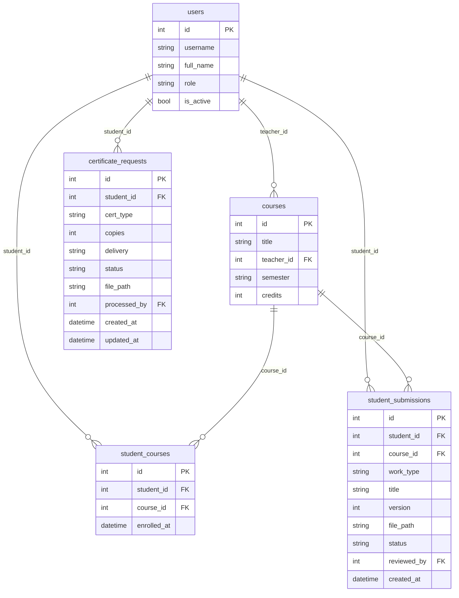
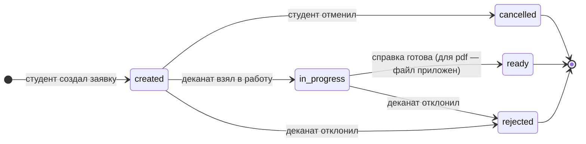
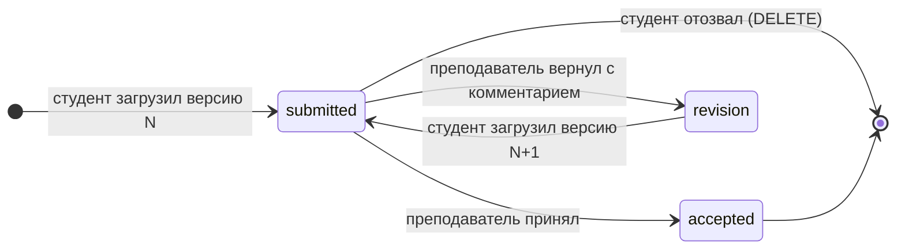

# Техническое задание: Backend модуля «Кабинет студента» (Student Portal)

## 1. Назначение модуля

«Кабинет студента» — личная страница студента в College Management System. В одном месте студент находит всё, что нужно для учёбы, и ему не приходится ходить за этим к преподавателям или в деканат: расписание, оценки и задолженности, посещаемость, объявления своей группы, заказ справок и сдачу учебных работ.

Backend модуля (`modules/student_portal/`) предоставляет REST API, к которому обращается frontend кабинета (`frontend/student_portal/`, issue #11).

**Откуда берутся данные.** Оценки, расписание и посещаемость вносят преподаватели и администраторы через другие модули (Gradebook, Schedule). Кабинет эти данные **только читает** из общих таблиц `core/` и никогда их не изменяет. Модулю принадлежат три вида данных:

1. **Записи студентов на курсы** — какие курсы изучает студент (таблица `student_courses`).
2. **Заявки на справки** в деканат и их статусы (таблица `certificate_requests`).
3. **Загруженные работы** (курсовые, лабораторные) и результат их проверки (таблица `student_submissions`).

**Кто что видит.** Каждый студент видит только свои данные. Идентификатор студента backend берёт из токена авторизации, а не из адреса запроса, поэтому запросить чужие оценки, пропуски, заявки или работы невозможно.

## 2. Функциональные требования

### 2.1. Основные функции

- **Вход в кабинет:** проверка логина и пароля, выдача токена доступа. Войти могут только активные пользователи с ролью `student`.
- **Профиль:** ФИО, логин, email и учебная группа текущего студента.
- **Главная страница (сводка):** занятия на сегодня, средний балл, число задолженностей, процент посещаемости, число активных заявок и работ на проверке, последние объявления группы.
- **Мои курсы:** список курсов, на которые записан студент, с преподавателем и количеством кредитов.
- **Расписание:** занятия студента на неделю с фильтром по дню недели.
- **Оценки и задолженности:** оценки по каждому курсу, средний балл по курсу и общий, статус курса («сдано», «задолженность», «в процессе»).
- **Посещаемость:** сводка по каждому курсу (присутствия, опоздания, пропуски, процент посещаемости) и детальный список отметок с фильтрами.
- **Объявления:** объявления, которые преподаватели публикуют для группы студента (данные модуля Teacher Portal).
- **Заказ справок:** каталог доступных справок, создание заявки, отслеживание статуса, отмена заявки до начала обработки, скачивание готовой справки в PDF.
- **Загрузка работ:** загрузка файла работы (PDF/DOCX, до 20 МБ) по своему курсу, история загрузок с версиями, статус проверки и комментарий преподавателя, повторная загрузка после замечаний, отзыв работы до начала проверки.
- **Служебные функции** (не для студента, но без них жизненный цикл данных модуля не замкнут):
  - сотрудник деканата (роль `admin`) берёт заявки в работу, прикладывает PDF и отмечает справку готовой или отклоняет заявку;
  - преподаватель (роль `teacher`) получает работы по своим курсам, скачивает их, принимает работу или возвращает на доработку с комментарием.

### 2.2. Пользовательские сценарии

**Сценарий 1: Вход в кабинет**

1. Студент открывает страницу входа, вводит логин и пароль.
2. Frontend отправляет `POST /api/v1/student_portal/auth/login`. Backend находит пользователя по `username`, проверяет пароль функцией `verify_password` из `core/auth.py`, убеждается, что учётная запись активна (`is_active = true`) и роль — `student`.
3. Backend выдаёт JWT-токен (`create_access_token` из `core/auth.py`, срок действия 30 минут). Данные в БД не меняются. Frontend сохраняет токен и передаёт его в заголовке `Authorization` во всех следующих запросах.

**Сценарий 2: Просмотр оценок и задолженностей**

1. Студент открывает раздел «Успеваемость» и выбирает семестр.
2. Frontend отправляет `GET /api/v1/student_portal/grades?semester=2026-1`. Backend определяет студента по токену, берёт его курсы из `student_courses`, оценки из таблицы `grades` (`core/`) и для каждого курса считает средний балл и статус.
3. Данные только читаются. Курсы со статусом `debt` frontend подсвечивает красным; общее число задолженностей приходит в поле `debts_count`.

**Сценарий 3: Заказ справки об обучении**

1. Студент открывает раздел «Справки» — frontend получает каталог через `GET /certificate-types`. Студент нажимает «Заказать» на карточке «Справка об обучении», выбирает 2 экземпляра и способ получения «бумажная в деканате».
2. Frontend отправляет `POST /api/v1/student_portal/certificates`. Backend проверяет, что такой тип справки существует, количество экземпляров в допустимых пределах, способ получения доступен для этого типа и у студента нет другой активной заявки на эту же справку.
3. В `certificate_requests` создаётся запись со статусом `created`. Ответ содержит `id` — номер заявки, который frontend показывает в подтверждении («Заявка №1234 успешно создана»). Заявка появляется первой в списке `GET /certificates`.

**Сценарий 4: Обработка заявки деканатом**

1. Сотрудник деканата (роль `admin`) получает очередь заявок через `GET /staff/certificates?status=created` и переводит заявку в статус `in_progress`.
2. Для электронной справки сотрудник загружает PDF (`POST /staff/certificates/{id}/file`), затем переводит заявку в `ready`. Backend проверяет допустимость перехода статуса и наличие файла.
3. Статус и `updated_at` заявки обновляются. Студент видит «Готова к выдаче» и может скачать PDF через `GET /certificates/{id}/file`.

**Сценарий 5: Сдача лабораторной работы и повторная загрузка после замечаний**

1. Студент в разделе «Мои работы» выбирает курс, тип работы «лабораторная», вводит название «Лабораторная работа №3» и перетаскивает файл `lab3.pdf`.
2. Frontend отправляет `POST /api/v1/student_portal/submissions` (multipart/form-data). Backend проверяет, что студент записан на курс, файл — PDF или DOCX и не больше 20 МБ, сохраняет файл на диск под сгенерированным именем.
3. В `student_submissions` появляется запись с `version = 1` и статусом `submitted`.
4. Преподаватель курса через `PATCH /staff/submissions/{id}` возвращает работу со статусом `revision` и комментарием «Нет выводов». Студент видит статус и комментарий.
5. Студент загружает исправленный файл с тем же курсом и названием. Backend находит предыдущую версию со статусом `revision` и создаёт запись с `version = 2`. Вся история версий остаётся доступной в `GET /submissions`.

**Сценарий 6: Просмотр расписания на завтра**

1. Студент на главном экране переключается на вкладку «Завтра».
2. Frontend вычисляет день недели и отправляет `GET /api/v1/student_portal/schedule?day_of_week=tuesday`. Backend выбирает занятия только тех курсов, на которые записан студент, и сортирует их по времени начала.
3. Данные только читаются; frontend рисует карточки занятий с временем, аудиторией и преподавателем.

## 3. Нефункциональные требования

- **Производительность:** ответ на любой `GET`-запрос — не более 300 мс в локальном окружении при объёме данных одного студента до 50 курсов, 1 000 оценок и 1 000 отметок посещаемости. Средние баллы и счётчики посещаемости считаются запросами к БД с группировкой, а не перебором в Python. Списки, которые растут со временем (отметки посещаемости, объявления, заявки, работы), отдаются с пагинацией. Загружаемый файл записывается на диск частями, а не читается в память целиком.
- **Безопасность:**
  - все эндпоинты, кроме `POST /auth/login`, требуют заголовок `Authorization: Bearer <token>`; без токена или с просроченным токеном — `401`;
  - эндпоинты студента доступны только роли `student`, служебные — только ролям, указанным в разделе 4.1 (иначе `403`);
  - идентификатор студента берётся только из токена; при обращении к чужой заявке или работе по `id` возвращается `404`, чтобы не раскрывать факт её существования;
  - при неудачном входе текст ошибки одинаковый для «нет такого логина» и «неверный пароль»;
  - пароли не возвращаются ни в одном ответе; хэширование и проверка — только через `core/auth.py`;
  - загружаемые файлы проверяются по расширению, MIME-типу и размеру; хранятся вне папки `frontend/` под сгенерированными именами (защита от подмены пути); скачать файл можно только через API с проверкой владельца;
  - все входные данные валидируются Pydantic-схемами.
- **Надёжность:** если запись в БД о загруженном файле не удалась, сохранённый файл удаляется (на диске не остаётся «осиротевших» файлов); при удалении работы удаляется и её файл.
- **Совместимость:** модуль использует общие компоненты `core/` (конфигурация, `get_db`, модели `User`, `Course`, `Schedule`, `Grade`, `Attendance`, функции из `auth.py` и `utils.py`) и не дублирует их. Структура кода повторяет `docs/examples/example_module/` (`models.py`, `schemas.py`, `router.py`, `tests/`), роутер подключается в `core/api.py`. Python 3.11 (как в CI), код проходит `flake8` (длина строки до 100), тесты — `pytest` с `TestClient`. Для приёма файлов в `requirements.txt` добавляется пакет `python-multipart` (его требует FastAPI для `UploadFile` и `Form`).
- **Формат данных:** JSON в UTF-8; дата — `YYYY-MM-DD`, дата и время — ISO 8601 (`2026-10-05T10:00:00`), время занятия — `HH:MM`.

## 4. Интерфейсы

### 4.1. API Endpoints

Раздел согласуется с frontend-командой модуля (issue #11) по чек-листу из wiki «API-контракт» до начала Модуля 2. Вопросы, которые нужно обсудить при сверке, собраны в разделе 7.3.

**Общие правила контракта**

- Все пути начинаются с `/api/v1/student_portal`.
- Авторизация: заголовок `Authorization: Bearer <token>`; токен выдаёт `POST /api/v1/student_portal/auth/login`. Все эндпоинты студента требуют роль `student`.
- Тело ошибки (кроме `422`): `{"detail": "Текст ошибки"}`. Ошибка `422` приходит в стандартном формате FastAPI.
- Списки отдаются объектом с полями `items` (массив) и `total` (общее число записей). Если у списка есть пагинация, добавляются поля `page` и `page_size`; query-параметры пагинации: `page` (по умолчанию 1) и `page_size` (по умолчанию 20, максимум 100).
- Если значение отсутствует, поле приходит со значением `null`, а не пропадает из ответа.
- Общие ошибки для всех эндпоинтов, кроме входа:
  - `401 Unauthorized` — нет токена, он недействителен или истёк: `{"detail": "Требуется авторизация"}`;
  - `403 Forbidden` — у пользователя не та роль: `{"detail": "Доступ только для студентов"}` (для служебных эндпоинтов — `{"detail": "Недостаточно прав"}`).

**Сводная таблица — эндпоинты кабинета студента**

| Метод  | Endpoint                                                  | Описание                                  | Успешный ответ | Ошибки                       |
| ------ | --------------------------------------------------------- | ----------------------------------------- | -------------- | ---------------------------- |
| POST   | `/api/v1/student_portal/auth/login`                       | Вход, получение токена                    | 200            | 401, 403, 422                |
| GET    | `/api/v1/student_portal/me`                               | Профиль текущего студента                 | 200            | —                            |
| GET    | `/api/v1/student_portal/dashboard`                        | Сводка для главной страницы               | 200            | —                            |
| GET    | `/api/v1/student_portal/courses`                          | Курсы студента                            | 200            | 422                          |
| GET    | `/api/v1/student_portal/schedule`                         | Расписание на неделю                      | 200            | 422                          |
| GET    | `/api/v1/student_portal/grades`                           | Оценки и задолженности по курсам          | 200            | 422                          |
| GET    | `/api/v1/student_portal/attendance`                       | Сводка посещаемости по курсам             | 200            | 422                          |
| GET    | `/api/v1/student_portal/attendance/records`               | Список отметок посещаемости               | 200            | 422                          |
| GET    | `/api/v1/student_portal/announcements`                    | Объявления группы студента                | 200            | 422                          |
| GET    | `/api/v1/student_portal/certificate-types`                | Каталог справок                           | 200            | —                            |
| GET    | `/api/v1/student_portal/certificates`                     | Мои заявки на справки                     | 200            | 422                          |
| POST   | `/api/v1/student_portal/certificates`                     | Заказать справку                          | 201            | 409, 422                     |
| GET    | `/api/v1/student_portal/certificates/{request_id}`        | Одна заявка                               | 200            | 404                          |
| POST   | `/api/v1/student_portal/certificates/{request_id}/cancel` | Отменить заявку                           | 200            | 404, 409                     |
| GET    | `/api/v1/student_portal/certificates/{request_id}/file`   | Скачать PDF справки                       | 200 (файл)     | 404, 409                     |
| GET    | `/api/v1/student_portal/submissions`                      | Мои работы (история загрузок)             | 200            | 422                          |
| POST   | `/api/v1/student_portal/submissions`                      | Загрузить работу                          | 201            | 403, 404, 409, 413, 415, 422 |
| GET    | `/api/v1/student_portal/submissions/{submission_id}`      | Одна работа                               | 200            | 404                          |
| GET    | `/api/v1/student_portal/submissions/{submission_id}/file` | Скачать свой файл                         | 200 (файл)     | 404                          |
| DELETE | `/api/v1/student_portal/submissions/{submission_id}`      | Отозвать работу до проверки               | 204            | 404, 409                     |

**Сводная таблица — служебные эндпоинты** (не используются frontend'ом кабинета студента, см. 4.1.9)

| Метод | Endpoint                                                        | Роль      | Описание                            | Успешный ответ | Ошибки                  |
| ----- | --------------------------------------------------------------- | --------- | ----------------------------------- | -------------- | ----------------------- |
| GET   | `/api/v1/student_portal/staff/certificates`                     | `admin`   | Очередь заявок на справки           | 200            | 422                     |
| PATCH | `/api/v1/student_portal/staff/certificates/{request_id}`        | `admin`   | Сменить статус заявки               | 200            | 404, 409, 422           |
| POST  | `/api/v1/student_portal/staff/certificates/{request_id}/file`   | `admin`   | Приложить PDF справки               | 200            | 404, 409, 413, 415      |
| GET   | `/api/v1/student_portal/staff/submissions`                      | `teacher` | Работы по курсам преподавателя      | 200            | 422                     |
| GET   | `/api/v1/student_portal/staff/submissions/{submission_id}/file` | `teacher` | Скачать файл работы                 | 200 (файл)     | 403, 404                |
| PATCH | `/api/v1/student_portal/staff/submissions/{submission_id}`      | `teacher` | Принять работу / вернуть на доработку | 200          | 403, 404, 409, 422      |

#### 4.1.1. Вход и профиль

##### `POST /api/v1/student_portal/auth/login`

**Назначение:** проверить логин и пароль и выдать токен доступа. Единственный эндпоинт без авторизации.

**Тело запроса:**

```json
{
  "username": "student1",
  "password": "student123"
}
```

| Поле       | Тип    | Обязательно | Описание                     |
| ---------- | ------ | ----------- | ---------------------------- |
| `username` | строка | да          | Логин, 1–50 символов         |
| `password` | строка | да          | Пароль, 1–128 символов       |

**Успешный ответ — `200 OK`:**

```json
{
  "access_token": "eyJhbGciOiJIUzI1NiIsInR5cCI6IkpXVCJ9...",
  "token_type": "bearer",
  "expires_in": 1800,
  "user": {
    "id": 3,
    "username": "student1",
    "full_name": "Иванов Иван Иванович",
    "email": "student@college.edu",
    "group_id": 2,
    "group_name": "ИС-31",
    "created_at": "2026-09-01T09:00:00"
  }
}
```

`expires_in` — срок жизни токена в секундах. В полезной нагрузке токена: `{"sub": "3", "role": "student", "exp": ...}`. После истечения срока любой запрос вернёт `401`, и frontend должен снова показать форму входа.

**Ошибки:**
- `401 Unauthorized` — неверный логин или пароль (одинаковый текст в обоих случаях): `{"detail": "Неверный логин или пароль"}`
- `403 Forbidden` — учётная запись заблокирована: `{"detail": "Учётная запись заблокирована"}`; роль не `student`: `{"detail": "Вход в кабинет доступен только студентам"}`
- `422 Unprocessable Entity` — не передано обязательное поле

##### `GET /api/v1/student_portal/me`

**Назначение:** профиль текущего студента (шапка кабинета).

**Параметры:** нет.

**Успешный ответ — `200 OK`:**

```json
{
  "id": 3,
  "username": "student1",
  "full_name": "Иванов Иван Иванович",
  "email": "student@college.edu",
  "group_id": 2,
  "group_name": "ИС-31",
  "created_at": "2026-09-01T09:00:00"
}
```

`group_id` и `group_name` равны `null`, если студент ещё не привязан к группе (привязку ведёт Admin Panel).

#### 4.1.2. Главная страница

##### `GET /api/v1/student_portal/dashboard`

**Назначение:** все данные для главного экрана одним запросом.

**Параметры:** нет.

**Успешный ответ — `200 OK`:**

```json
{
  "date": "2026-10-05",
  "day_of_week": "monday",
  "today_lessons": [
    {
      "id": 12,
      "day_of_week": "monday",
      "time_start": "09:00",
      "time_end": "10:30",
      "room": "305",
      "building": "Главный корпус",
      "course_id": 4,
      "course_title": "Разработка программных модулей",
      "teacher_name": "Петров Пётр Петрович"
    }
  ],
  "average_grade": 4.25,
  "debts_count": 1,
  "attendance_percent": 92.5,
  "active_certificate_requests": 1,
  "submissions_on_review": 2,
  "submissions_need_revision": 1,
  "latest_announcements": [
    {
      "id": 15,
      "title": "Перенос лекции",
      "text": "Лекция в четверг переносится на пятницу, аудитория 305.",
      "teacher_name": "Петров Пётр Петрович",
      "created_at": "2026-10-03T14:30:00",
      "updated_at": "2026-10-03T14:30:00"
    }
  ]
}
```

- `today_lessons` — занятия на текущий день недели (формат как в `GET /schedule`), по времени начала; пустой массив, если занятий нет.
- `average_grade` — средний балл по всем оценкам (как поле `average` в `GET /grades`); `null`, если оценок нет.
- `debts_count` — число курсов со статусом `debt`.
- `attendance_percent` — общий процент посещаемости (как `overall.attendance_percent` в `GET /attendance`); `null`, если отметок нет.
- `active_certificate_requests` — заявки в статусах `created` и `in_progress`.
- `submissions_on_review` / `submissions_need_revision` — последние версии работ в статусах `submitted` / `revision`.
- `latest_announcements` — до 3 последних объявлений группы (формат как в `GET /announcements`).

#### 4.1.3. Курсы и расписание

**Объект курса:**

```json
{
  "id": 4,
  "title": "Разработка программных модулей",
  "description": "Проектирование и разработка модулей информационных систем",
  "semester": "2026-1",
  "credits": 3,
  "teacher": {
    "id": 2,
    "full_name": "Петров Пётр Петрович"
  }
}
```

`semester` — строка из `courses.semester` в том виде, в каком её хранит `core/`.

##### `GET /api/v1/student_portal/courses`

**Назначение:** курсы, на которые записан студент.

**Query-параметры (необязательные):** `semester` (строка) — показать курсы только этого семестра.

**Успешный ответ — `200 OK`:**

```json
{
  "items": [
    {
      "id": 4,
      "title": "Разработка программных модулей",
      "description": "Проектирование и разработка модулей информационных систем",
      "semester": "2026-1",
      "credits": 3,
      "teacher": {"id": 2, "full_name": "Петров Пётр Петрович"}
    }
  ],
  "total": 1
}
```

Курсы отсортированы по названию. Если студент не записан ни на один курс — `{"items": [], "total": 0}`.

**Ошибки:** `422` — некорректное значение параметра.

##### `GET /api/v1/student_portal/schedule`

**Назначение:** расписание студента на неделю (занятия курсов, на которые он записан).

**Query-параметры (необязательные):**

| Параметр      | Тип    | Описание                                                                        |
| ------------- | ------ | ------------------------------------------------------------------------------- |
| `day_of_week` | строка | Один день: `monday`, `tuesday`, `wednesday`, `thursday`, `friday`, `saturday`, `sunday` |

**Успешный ответ — `200 OK`:**

```json
{
  "items": [
    {
      "id": 12,
      "day_of_week": "monday",
      "time_start": "09:00",
      "time_end": "10:30",
      "room": "305",
      "building": "Главный корпус",
      "course_id": 4,
      "course_title": "Разработка программных модулей",
      "teacher_name": "Петров Пётр Петрович"
    }
  ],
  "total": 1
}
```

Занятия отсортированы по дню недели (с понедельника) и времени начала. `building` может быть `null`. Если занятий нет — `{"items": [], "total": 0}`.

**Ошибки:** `422` — неизвестное значение `day_of_week`.

#### 4.1.4. Оценки и задолженности

##### `GET /api/v1/student_portal/grades`

**Назначение:** оценки студента, сгруппированные по курсам, со средним баллом и статусом каждого курса.

**Query-параметры (необязательные):** `semester` (строка), `course_id` (целое число).

**Успешный ответ — `200 OK`:**

```json
{
  "items": [
    {
      "course_id": 4,
      "course_title": "Разработка программных модулей",
      "semester": "2026-1",
      "credits": 3,
      "teacher_name": "Петров Пётр Петрович",
      "grades": [
        {"id": 51, "grade": 4.0, "comment": null, "graded_at": "2026-09-20T12:00:00"},
        {"id": 58, "grade": 5.0, "comment": "Отличная лабораторная", "graded_at": "2026-10-01T12:00:00"}
      ],
      "average": 4.5,
      "status": "passed"
    },
    {
      "course_id": 6,
      "course_title": "Компьютерные сети",
      "semester": "2026-1",
      "credits": 2,
      "teacher_name": "Сидорова Анна Сергеевна",
      "grades": [],
      "average": null,
      "status": "in_progress"
    }
  ],
  "total": 2,
  "average": 4.5,
  "debts_count": 0
}
```

- В списке — **все** курсы студента (с учётом фильтров), в том числе без оценок; сортировка по названию курса. Оценки внутри курса — по дате, от старых к новым.
- Шкала оценок — от 2 до 5 (как в Gradebook); `grade` — число.
- `average` курса и общий `average` считаются функцией `calculate_gpa` из `core/utils.py` (среднее арифметическое, 2 знака после запятой); `null`, если оценок нет.
- `status` курса:
  - `in_progress` — оценок по курсу пока нет («В процессе»);
  - `debt` — средний балл меньше 3.0 («Задолженность»);
  - `passed` — средний балл 3.0 и выше («Сдано»).
- `debts_count` — число курсов со статусом `debt` в выдаче.
- Если `course_id` не относится к курсам студента, возвращается пустой список.

**Ошибки:** `422` — `course_id` не целое число.

#### 4.1.5. Посещаемость

Значения статуса отметки (поле `attendances.status`, согласуется с Gradebook): `present` — был, `late` — опоздал, `absent` — пропуск, `excused` — пропуск по уважительной причине.

##### `GET /api/v1/student_portal/attendance`

**Назначение:** сводка посещаемости по каждому курсу и в целом.

**Query-параметры (необязательные):**

| Параметр    | Тип    | Описание                               |
| ----------- | ------ | -------------------------------------- |
| `semester`  | строка | Только курсы этого семестра            |
| `date_from` | дата   | Начало периода (`YYYY-MM-DD`)          |
| `date_to`   | дата   | Конец периода включительно             |

**Успешный ответ — `200 OK`:**

```json
{
  "items": [
    {
      "course_id": 4,
      "course_title": "Разработка программных модулей",
      "total": 20,
      "present": 17,
      "late": 1,
      "absent": 2,
      "excused": 0,
      "attendance_percent": 90.0
    }
  ],
  "total": 1,
  "overall": {
    "total": 20,
    "present": 17,
    "late": 1,
    "absent": 2,
    "excused": 0,
    "attendance_percent": 90.0
  }
}
```

- `total` внутри курса — число отметок; поле `total` верхнего уровня — число курсов в `items`.
- `attendance_percent` = (`present` + `late`) / `total` × 100, округление до 1 знака; `null`, если отметок нет.
- В `items` — все курсы студента, включая курсы без отметок.

**Ошибки:** `422` — неверный формат даты или `date_from` позже `date_to`.

##### `GET /api/v1/student_portal/attendance/records`

**Назначение:** детальный список отметок, например «все мои пропуски по курсу».

**Query-параметры (необязательные):** `course_id` (целое), `status` (`present`, `late`, `absent`, `excused`), `date_from`, `date_to` (`YYYY-MM-DD`), `page`, `page_size`.

**Успешный ответ — `200 OK`:**

```json
{
  "items": [
    {
      "id": 301,
      "date": "2026-10-02",
      "course_id": 4,
      "course_title": "Разработка программных модулей",
      "status": "absent",
      "comment": null
    }
  ],
  "total": 1,
  "page": 1,
  "page_size": 20
}
```

Отметки отсортированы по дате, от новых к старым.

**Ошибки:** `422` — неизвестный `status`, неверный формат даты, `date_from` позже `date_to`, некорректная пагинация.

#### 4.1.6. Объявления

##### `GET /api/v1/student_portal/announcements`

**Назначение:** объявления преподавателей для группы студента (лента уведомлений).

**Query-параметры (необязательные):** `page`, `page_size`.

**Успешный ответ — `200 OK`:**

```json
{
  "items": [
    {
      "id": 15,
      "title": "Перенос лекции",
      "text": "Лекция в четверг переносится на пятницу, аудитория 305.",
      "teacher_name": "Петров Пётр Петрович",
      "created_at": "2026-10-03T14:30:00",
      "updated_at": "2026-10-03T14:30:00"
    }
  ],
  "total": 1,
  "page": 1,
  "page_size": 20
}
```

От новых к старым. Если студент не привязан к группе — `{"items": [], "total": 0, "page": 1, "page_size": 20}`.

**Ошибки:** `422` — некорректная пагинация.

#### 4.1.7. Справки

**Каталог справок** (хранится в коде модуля, см. 5.2):

| `code`              | Название                       | Способы получения | Максимум экземпляров |
| ------------------- | ------------------------------ | ----------------- | -------------------- |
| `study`             | Справка об обучении            | `pdf`, `paper`    | 5                    |
| `tax_deduction`     | Справка для налогового вычета  | `paper`           | 2                    |
| `grades_transcript` | Выписка оценок                 | `pdf`, `paper`    | 3                    |

`pdf` — электронная справка (скачивается из кабинета), `paper` — бумажная, выдаётся в деканате.

**Статусы заявки:**

| Статус        | Подпись в интерфейсе | Кто переводит         |
| ------------- | -------------------- | --------------------- |
| `created`     | Создана              | студент (при создании) |
| `in_progress` | В работе             | деканат               |
| `ready`       | Готова к выдаче      | деканат               |
| `rejected`    | Отклонена            | деканат (с причиной)  |
| `cancelled`   | Отменена             | студент               |

**Объект заявки:**

```json
{
  "id": 1234,
  "type": "study",
  "type_name": "Справка об обучении",
  "copies": 2,
  "delivery": "paper",
  "comment": "Для предоставления по месту работы родителей",
  "status": "created",
  "status_comment": null,
  "has_file": false,
  "created_at": "2026-10-05T10:00:00",
  "updated_at": "2026-10-05T10:00:00"
}
```

`id` — номер заявки, который видит студент. `status_comment` — комментарий деканата (обязателен при отклонении). `has_file` — приложен ли PDF справки.

##### `GET /api/v1/student_portal/certificate-types`

**Назначение:** каталог справок для карточек на экране «Справки».

**Параметры:** нет.

**Успешный ответ — `200 OK`:**

```json
{
  "items": [
    {
      "code": "study",
      "name": "Справка об обучении",
      "description": "Подтверждает, что студент обучается в колледже",
      "delivery_options": ["pdf", "paper"],
      "max_copies": 5
    }
  ],
  "total": 3
}
```

##### `GET /api/v1/student_portal/certificates`

**Назначение:** таблица «Мои заявки».

**Query-параметры (необязательные):** `status` (одно из значений статуса), `page`, `page_size`.

**Успешный ответ — `200 OK`:** `{"items": [<объект заявки>, ...], "total": 1, "page": 1, "page_size": 20}`. Сортировка — от новых к старым.

**Ошибки:** `422` — неизвестный `status` или некорректная пагинация.

##### `POST /api/v1/student_portal/certificates`

**Назначение:** заказать справку.

**Тело запроса:**

```json
{
  "type": "study",
  "copies": 2,
  "delivery": "paper",
  "comment": "Для предоставления по месту работы родителей"
}
```

| Поле       | Тип    | Обязательно | Описание                                                    |
| ---------- | ------ | ----------- | ----------------------------------------------------------- |
| `type`     | строка | да          | `code` из каталога справок                                  |
| `copies`   | число  | да          | От 1 до `max_copies` этого типа                             |
| `delivery` | строка | да          | `pdf` или `paper`; должен входить в `delivery_options` типа |
| `comment`  | строка | нет         | Пояснение для деканата, до 500 символов                     |

**Успешный ответ — `201 Created`:** объект созданной заявки со статусом `created`.

**Ошибки:**
- `409 Conflict` — у студента уже есть заявка этого типа в статусе `created` или `in_progress`: `{"detail": "У вас уже есть активная заявка на эту справку"}`
- `422 Unprocessable Entity` — неизвестный тип справки, недопустимое число экземпляров или способ получения, слишком длинный комментарий

##### `GET /api/v1/student_portal/certificates/{request_id}`

**Параметры пути:** `request_id` (целое число).

**Успешный ответ — `200 OK`:** объект заявки.

**Ошибка — `404 Not Found`** (заявки нет или она принадлежит другому студенту): `{"detail": "Заявка не найдена"}`

##### `POST /api/v1/student_portal/certificates/{request_id}/cancel`

**Назначение:** отменить свою заявку, пока деканат не взял её в работу.

**Тело запроса:** нет.

**Успешный ответ — `200 OK`:** объект заявки со статусом `cancelled`.

**Ошибки:**
- `404` — заявка не найдена
- `409 Conflict` — заявка не в статусе `created`: `{"detail": "Заявку можно отменить только до начала обработки"}`

##### `GET /api/v1/student_portal/certificates/{request_id}/file`

**Назначение:** скачать электронную справку.

**Успешный ответ — `200 OK`:** файл, `Content-Type: application/pdf`, `Content-Disposition: attachment; filename="spravka-1234.pdf"`.

**Ошибки:**
- `404` — заявка не найдена
- `409 Conflict` — файл ещё не приложен: `{"detail": "Файл справки ещё не готов"}`

#### 4.1.8. Учебные работы

**Типы работ (`work_type`):** `coursework` — курсовая, `lab` — лабораторная, `other` — другое.

**Статусы работы:**

| Статус      | Подпись в интерфейсе | Кто переводит               |
| ----------- | -------------------- | --------------------------- |
| `submitted` | На проверке          | студент (при загрузке)      |
| `accepted`  | Принята              | преподаватель               |
| `revision`  | Нужна доработка      | преподаватель (с комментарием) |

**Версии.** Работа определяется сочетанием «курс + название» (название сравнивается без учёта регистра и пробелов по краям). Каждая загрузка — отдельная запись со своим номером версии; история не удаляется при повторной загрузке.

**Объект работы:**

```json
{
  "id": 77,
  "course_id": 4,
  "course_title": "Разработка программных модулей",
  "work_type": "lab",
  "title": "Лабораторная работа №3",
  "version": 2,
  "file_name": "lab3_ivanov.pdf",
  "file_size": 482133,
  "status": "submitted",
  "teacher_comment": null,
  "reviewed_at": null,
  "created_at": "2026-10-06T18:20:00"
}
```

`file_name` — исходное имя файла, `file_size` — размер в байтах.

##### `GET /api/v1/student_portal/submissions`

**Назначение:** история загрузок студента.

**Query-параметры (необязательные):** `course_id` (целое), `status` (`submitted`, `accepted`, `revision`), `work_type`, `page`, `page_size`.

**Успешный ответ — `200 OK`:** `{"items": [<объект работы>, ...], "total": 1, "page": 1, "page_size": 20}`. Возвращаются все версии, от новых к старым.

**Ошибки:** `422` — неизвестный `status` / `work_type` или некорректная пагинация.

##### `POST /api/v1/student_portal/submissions`

**Назначение:** загрузить работу (новую или новую версию после доработки).

**Тело запроса:** `multipart/form-data`.

| Поле        | Тип    | Обязательно | Описание                                         |
| ----------- | ------ | ----------- | ------------------------------------------------ |
| `course_id` | число  | да          | Курс, на который записан студент                 |
| `work_type` | строка | да          | `coursework`, `lab` или `other`                  |
| `title`     | строка | да          | Название работы, 1–200 символов                  |
| `file`      | файл   | да          | `.pdf` или `.docx`, не пустой, не больше 20 МБ   |

Пример запроса на frontend:

```js
const form = new FormData();
form.append("course_id", 4);
form.append("work_type", "lab");
form.append("title", "Лабораторная работа №3");
form.append("file", fileInput.files[0]);
fetch("/api/v1/student_portal/submissions", {
  method: "POST",
  headers: {Authorization: `Bearer ${token}`},  // Content-Type не задаём — его выставит браузер
  body: form,
});
```

**Правила версий:**
- работы с таким курсом и названием ещё нет — создаётся версия 1;
- последняя версия в статусе `revision` — создаётся версия N+1;
- последняя версия в статусе `submitted` или `accepted` — ошибка `409` (см. ниже).

**Успешный ответ — `201 Created`:** объект созданной работы со статусом `submitted`.

**Ошибки:**
- `403 Forbidden` — студент не записан на курс: `{"detail": "Вы не записаны на этот курс"}`
- `404 Not Found` — курса нет: `{"detail": "Курс не найден"}`
- `409 Conflict` — предыдущая версия ещё на проверке: `{"detail": "Предыдущая версия работы ещё на проверке"}`; работа уже принята: `{"detail": "Работа уже принята преподавателем"}`
- `413 Request Entity Too Large` — файл больше 20 МБ: `{"detail": "Размер файла превышает 20 МБ"}`
- `415 Unsupported Media Type` — не PDF/DOCX: `{"detail": "Допустимы только файлы PDF и DOCX"}`
- `422 Unprocessable Entity` — не передано обязательное поле, пустой файл, неизвестный `work_type`

##### `GET /api/v1/student_portal/submissions/{submission_id}`

**Успешный ответ — `200 OK`:** объект работы.

**Ошибка — `404 Not Found`** (работы нет или она чужая): `{"detail": "Работа не найдена"}`

##### `GET /api/v1/student_portal/submissions/{submission_id}/file`

**Успешный ответ — `200 OK`:** файл с исходным именем (`Content-Disposition: attachment`) и исходным `Content-Type`.

**Ошибка — `404 Not Found`:** `{"detail": "Работа не найдена"}`

##### `DELETE /api/v1/student_portal/submissions/{submission_id}`

**Назначение:** отозвать версию, которую преподаватель ещё не проверил (например, загружен не тот файл). Запись и файл удаляются.

**Успешный ответ — `204 No Content`** (тела нет).

**Ошибки:**
- `404` — работа не найдена
- `409 Conflict` — работа уже проверена: `{"detail": "Проверенную работу удалить нельзя"}`

#### 4.1.9. Служебные эндпоинты

Эти эндпоинты не нужны frontend'у кабинета студента. Ими пользуются деканат (роль `admin`) и преподаватели (роль `teacher`): через интерфейсы Admin Panel / Teacher Portal, если команды этих модулей добавят такие экраны, или через Swagger UI (`/docs`). Другая роль — `403 {"detail": "Недостаточно прав"}`.

В ответах служебных эндпоинтов объект заявки или работы дополняется полем `student`:

```json
"student": {"id": 3, "full_name": "Иванов Иван Иванович"}
```

##### `GET /api/v1/student_portal/staff/certificates` — роль `admin`

**Query-параметры (необязательные):** `status`, `type`, `page`, `page_size`.

**Успешный ответ — `200 OK`:** список заявок всех студентов в общем формате, от старых к новым (очередь).

**Ошибки:** `422` — неизвестный `status` / `type`.

##### `PATCH /api/v1/student_portal/staff/certificates/{request_id}` — роль `admin`

**Тело запроса:**

```json
{
  "status": "rejected",
  "status_comment": "Справка этого типа выдаётся только студентам очной формы"
}
```

Допустимые переходы: `created → in_progress`, `created → rejected`, `in_progress → ready`, `in_progress → rejected`. При `rejected` поле `status_comment` обязательно (1–500 символов). Переход в `ready` для заявки с `delivery = "pdf"` возможен только после загрузки файла.

**Успешный ответ — `200 OK`:** обновлённый объект заявки.

**Ошибки:**
- `404` — заявка не найдена
- `409 Conflict` — недопустимый переход: `{"detail": "Недопустимый переход статуса: ready → in_progress"}`; нет файла для электронной справки: `{"detail": "Сначала приложите PDF справки"}`
- `422` — неизвестный статус, нет `status_comment` при отклонении

##### `POST /api/v1/student_portal/staff/certificates/{request_id}/file` — роль `admin`

**Тело запроса:** `multipart/form-data`, поле `file` — PDF не больше 5 МБ. Повторная загрузка заменяет файл.

**Успешный ответ — `200 OK`:** объект заявки с `has_file: true`.

**Ошибки:** `404` — заявка не найдена; `409` — заявка не в статусе `in_progress`: `{"detail": "Файл можно приложить только к заявке в работе"}`; `413` — файл больше 5 МБ; `415` — не PDF.

##### `GET /api/v1/student_portal/staff/submissions` — роль `teacher`

**Query-параметры (необязательные):** `course_id`, `status` (по умолчанию `submitted`), `page`, `page_size`.

**Успешный ответ — `200 OK`:** работы только по курсам, где `courses.teacher_id` — текущий преподаватель, в общем формате списка, от старых к новым.

**Ошибки:** `422` — некорректные параметры.

##### `GET /api/v1/student_portal/staff/submissions/{submission_id}/file` — роль `teacher`

**Успешный ответ — `200 OK`:** файл работы.

**Ошибки:** `403` — работа по чужому курсу: `{"detail": "Работа относится к курсу другого преподавателя"}`; `404` — работа не найдена.

##### `PATCH /api/v1/student_portal/staff/submissions/{submission_id}` — роль `teacher`

**Тело запроса:**

```json
{
  "status": "revision",
  "teacher_comment": "Нет выводов по результатам эксперимента"
}
```

| Поле              | Тип    | Обязательно               | Описание                       |
| ----------------- | ------ | ------------------------- | ------------------------------ |
| `status`          | строка | да                        | `accepted` или `revision`      |
| `teacher_comment` | строка | да, если `revision`       | 1–1000 символов                |

Проверить можно только работу в статусе `submitted`. Backend записывает `reviewed_by` и `reviewed_at`.

**Успешный ответ — `200 OK`:** обновлённый объект работы.

**Ошибки:** `403` — работа по чужому курсу; `404` — работа не найдена; `409` — работа уже проверена: `{"detail": "Работа уже проверена"}`; `422` — неизвестный статус или нет комментария при `revision`.

### 4.2. Взаимодействие с другими модулями

- **core/ (ядро):**
  - `database.get_db` — сессия БД; `config.SECRET_KEY` — ключ подписи токенов;
  - `models.User`, `Course`, `Schedule`, `Grade`, `Attendance` — модуль читает эти таблицы и не изменяет их;
  - `auth.verify_password` и `auth.create_access_token` — вход и выдача токена;
  - `utils.calculate_gpa` — средний балл.
  - Для проверки токена всем модулям нужна общая зависимость `get_current_user` (декодирование JWT и загрузка пользователя). Предлагаем добавить её в `core/auth.py` вместе с командами Teacher Portal и Admin Panel; пока её нет, модуль держит свою реализацию в `modules/student_portal/dependencies.py` на том же `SECRET_KEY` и алгоритме `HS256`.
- **Gradebook (issue #17):** вносит оценки (`grades`) и отметки посещаемости (`attendances`). Нужно согласовать: шкала оценок 2–5; значения `attendances.status` — `present`, `late`, `absent`, `excused`.
- **Schedule (issue #20):** ведёт таблицу `schedules`. Нужно согласовать формат: `day_of_week` — `monday` … `sunday` (латиницей, в нижнем регистре), `time_start` / `time_end` — `HH:MM`.
- **Admin Panel (issue #15):** ведёт учётные записи и группы. Модуль читает `users.group_id` и `student_groups.name` для профиля и объявлений; заблокированный пользователь (`is_active = false`) не может войти в кабинет. Сотрудники деканата с ролью `admin` обрабатывают заявки через служебные эндпоинты 4.1.9. Запись студентов на курсы (`student_courses`) пока заполняется скриптом `scripts/seed_data.py`; в дальнейшем — предлагаем Admin Panel.
- **Teacher Portal (issue #23):** создаёт объявления (таблица `announcements`) — кабинет студента показывает объявления группы студента. Преподаватели проверяют работы через служебные эндпоинты 4.1.9.
- **Reports (issue #21):** при необходимости может читать `certificate_requests` и `student_submissions` для статистики; формат таблиц — в разделе 5.
- **Student Portal — Frontend (issue #11):** потребитель всех эндпоинтов кабинета студента из раздела 4.1 (кроме служебных).

## 5. Структура базы данных

### 5.1. Таблицы

Модуль создаёт три собственные таблицы (модели — в `modules/student_portal/models.py`). Таблицы `users`, `courses`, `schedules`, `grades`, `attendances` (`core/`), `student_groups` (Admin Panel) и `announcements` (Teacher Portal) модуль только читает.

**Таблица:** `student_courses` (запись студента на курс)

| Поле        | Тип      | Описание                                            |
| ----------- | -------- | --------------------------------------------------- |
| id          | Integer  | Первичный ключ                                      |
| student_id  | Integer  | Внешний ключ на `users.id` (пользователь с ролью `student`) |
| course_id   | Integer  | Внешний ключ на `courses.id`                        |
| enrolled_at | DateTime | Дата записи на курс                                 |

Сочетание `student_id` + `course_id` уникально.

**Таблица:** `certificate_requests` (заявки на справки)

| Поле           | Тип          | Описание                                                       |
| -------------- | ------------ | -------------------------------------------------------------- |
| id             | Integer      | Первичный ключ, номер заявки                                   |
| student_id     | Integer      | Внешний ключ на `users.id`                                     |
| cert_type      | String(30)   | Код типа справки из каталога (5.2)                             |
| copies         | Integer      | Количество экземпляров                                         |
| delivery       | String(10)   | `pdf` или `paper`                                              |
| comment        | Text         | Комментарий студента, может быть NULL                          |
| status         | String(20)   | `created`, `in_progress`, `ready`, `rejected`, `cancelled`     |
| status_comment | Text         | Комментарий деканата, может быть NULL                          |
| file_path      | String(255)  | Путь к PDF справки на диске, может быть NULL                   |
| processed_by   | Integer      | Внешний ключ на `users.id` — сотрудник деканата, может быть NULL |
| created_at     | DateTime     | Время создания                                                 |
| updated_at     | DateTime     | Время последнего изменения                                     |

Индекс по (`student_id`, `status`) — для проверки активных заявок и фильтрации списка.

**Таблица:** `student_submissions` (загруженные работы, одна строка — одна версия)

| Поле            | Тип          | Описание                                                  |
| --------------- | ------------ | --------------------------------------------------------- |
| id              | Integer      | Первичный ключ                                            |
| student_id      | Integer      | Внешний ключ на `users.id`                                |
| course_id       | Integer      | Внешний ключ на `courses.id`                              |
| work_type       | String(20)   | `coursework`, `lab`, `other`                              |
| title           | String(200)  | Название работы                                           |
| version         | Integer      | Номер версии, начиная с 1                                 |
| file_name       | String(255)  | Исходное имя файла                                        |
| file_path       | String(255)  | Путь к файлу на диске (сгенерированное имя)               |
| file_size       | Integer      | Размер файла в байтах                                     |
| content_type    | String(100)  | MIME-тип файла                                            |
| status          | String(20)   | `submitted`, `accepted`, `revision`                       |
| teacher_comment | Text         | Комментарий преподавателя, может быть NULL                |
| reviewed_by     | Integer      | Внешний ключ на `users.id` — проверивший преподаватель, может быть NULL |
| reviewed_at     | DateTime     | Время проверки, может быть NULL                           |
| created_at      | DateTime     | Время загрузки                                            |

Сочетание `student_id` + `course_id` + `title` + `version` уникально; индекс по `course_id` — для выборки работ преподавателем.

### 5.2. Справочники в коде

Каталог справок (код, название, описание, способы получения, максимум экземпляров), а также наборы допустимых статусов и типов работ хранятся константами в `modules/student_portal/constants.py`, а не в БД: они меняются редко и только вместе с кодом. Статусы в Pydantic-схемах описываются через `Enum`, поэтому неизвестное значение автоматически даёт `422`.

### 5.3. Хранение файлов

- Файлы работ и справок хранятся на диске в папке `uploads/student_portal/` (путь задаётся переменной окружения `STUDENT_PORTAL_UPLOAD_DIR`, по умолчанию `<корень проекта>/uploads/student_portal`): `submissions/<student_id>/<uuid4>.<pdf|docx>` и `certificates/<request_id>.pdf`.
- В БД хранится только путь и исходное имя файла. Папка `uploads/` добавляется в `.gitignore`.
- Папка не раздаётся как статика: файлы отдаются только через эндпоинты `.../file` после проверки владельца или роли.

## 6. Критерии приёмки

- [ ] Все функции из раздела 2.1 реализованы, эндпоинты из раздела 4.1 работают по описанному контракту (пути, коды ответов, формат JSON)
- [ ] Вход: активный студент получает токен; неверный пароль — `401`; заблокированный пользователь и не-студент — `403`
- [ ] Студент получает только свои данные; запрос чужой заявки или работы по `id` даёт `404`
- [ ] Данные Gradebook и Schedule (оценки, посещаемость, расписание) модуль только читает и не изменяет
- [ ] Загрузка работ: проверяются тип и размер файла, корректно работают версии и запреты `409`
- [ ] Переходы статусов заявок и работ соответствуют диаграммам в разделе 7.2
- [ ] Тесты (`modules/student_portal/tests/`) написаны и проходят (`pytest`): успешные сценарии и ошибки `401`, `403`, `404`, `409`, `413`, `415`, `422`
- [ ] CI зелёный (`pytest` + `flake8`)
- [ ] Роутер подключён в `core/api.py`, таблицы создаются командой `python main.py init`
- [ ] Раздел 4.1 согласован с `specification-frontend.md` этого модуля (см. чек-лист в wiki «API-контракт»)
- [ ] Pull Request создан и принят

## 7. Приложения

### 7.1. Схема связей таблиц



Таблицы `users` и `courses` показаны частично — это таблицы `core/`, модуль их только читает.

### 7.2. Жизненный цикл заявки и работы





### 7.3. Вопросы для сверки с frontend-командой (issue #11)

Wiki-ТЗ дизайна кабинета студента описывает элементы, для которых в системе пока нет данных. Предлагаем обсудить при сверке контракта:

1. **«Ближайшие дедлайны» на главной.** Ни один модуль не хранит сроки сдачи работ. Предлагаем на Модуль 2 показывать вместо них работы, возвращённые на доработку (`submissions_need_revision` в `/dashboard`).
2. **Расписание: режимы «Семестр», фильтры по типу занятия и чётности недели, кнопка «Подключиться».** В таблице `schedules` нет типа занятия, чётности недели и ссылки на онлайн-пару — расписание еженедельное. Эти поля появятся в ответе `/schedule`, только если их добавит модуль Schedule.
3. **Баллы БРС, ECTS, форма контроля (экзамен/зачёт).** В `core/` есть только оценки 2–5 и `credits` курса. Кабинет отдаёт средний балл, кредиты и статус курса.
4. **Подпись статуса новой заявки.** В сценарии дизайна новая заявка получает статус «В обработке», а в таблице «Мои заявки» — «Создана». В API это один статус `created`; нужно выбрать одну подпись.
5. **Прогресс-бар загрузки.** `fetch()` не сообщает о прогрессе отправки; для прогресс-бара frontend может использовать `XMLHttpRequest` и событие `upload.onprogress` — эндпоинт `POST /submissions` от этого не меняется.
6. **Лента уведомлений** на главной строится по `latest_announcements` из `/dashboard` и `GET /announcements`; отдельного эндпоинта уведомлений об изменениях расписания и новых оценках нет.
